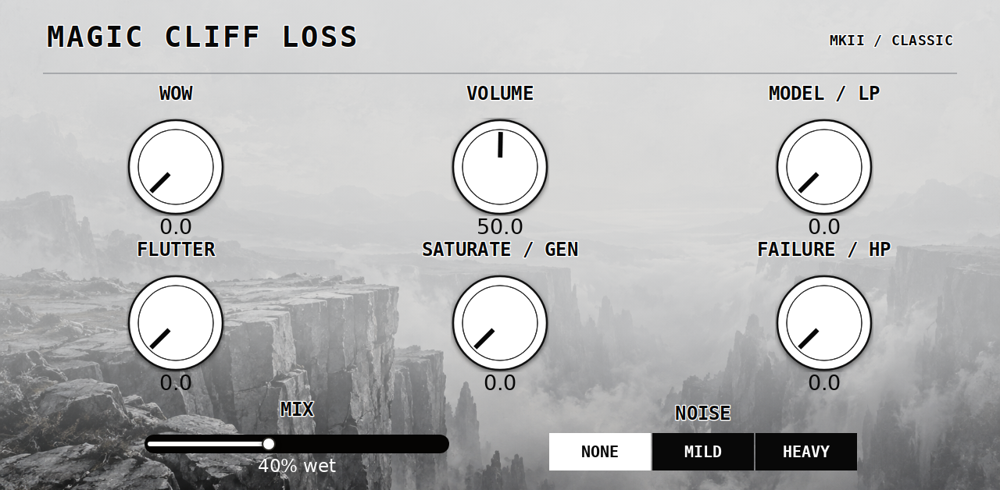

# Clif Loss

Experimental stereo tape-degradation **insert effect** for ARMv7 Akai Force / MPC Gen1 custom-plugin setups, by MagicStino.

Large white knobs with black indicator lines, clear outlined labels, a grey cliff background, and **Mix starting at 40% wet**. Tape Stop and pedal-style Aux controls are intentionally omitted; use the host's insert bypass.

## Source and build

[Download the complete source archive](Clif-Loss-source.zip), extract it, and follow its README. It contains the C++ plugin, skin generators/artwork, native presets, tests and firmware research tools. The source is distributed here as an archive.

The digital engine uses a **locally supplied Generation Loss MKII 1.1.0 firmware file**. Firmware, the generated firmware header, and binaries containing firmware are excluded from this repository. The build validates the firmware SHA256. No firmware redistribution license is granted by this project.

This is an experimental ARM custom-host plugin, **not a stock Akai installation or a desktop x86 VST**. The supplied skin targets OS 3.x. Compatible third-party-plugin support is required.

## Sound controls

- Tape: Wow, Volume, Model/LP, Flutter, Saturate/Gen, Failure/HP, Mix and Noise.
- Character: Hiss, Mechanical Noise, Crinkle/Pop, Hum Bypass, Classic, Mono to Stereo and Spread.

All 15 visible controls are automatable and mapped across two Q-Link pages. Mix is a continuous linear blend: 0% original audio, 100% processed audio. The firmware's parallel dry signal is disabled to avoid doubling it.

## Presets

Fifteen built-in VST programs and fifteen native MPC `.xpl` effect presets: **Clean Start, Soft Focus, Warm VHS, Worn Cassette, Rhodes Drive, Noisy Rhodes, Wide Memories, Cliff Edge, Dusty Loop, Classic Haze, Velvet Keys, Chorus Drift, Crunchy Drums, Old Radio, Broken Reel**. All start at 40% wet. [Preset descriptions](PRESETS.md).

Native containers were decoded and loaded into the actual ARM library. All controls and names restore correctly; an edited Mix and custom name also restore in a fresh instance. The installer resolves the preset's plugin path. Preset loading and sound were confirmed by the user on Force.

## Verification and findings

Digital-core comparison: 8192 stereo frames in each of four routing modes match the original firmware bit-for-bit in the tested configurations. ARM-host checks cover parameter/state validation, independent instances, variable block sizes, four sample rates, bypass latency, all presets and the Mix blend.

**Still unverified on hardware:** CPU headroom, Q-Link order, automation recording, project recall and the preview.3 UI-refresh fix. There was no physical pedal available; digital-core equality does not establish the analog sound of the complete pedal.

[Reusable findings log for the next firmware project](Clif-Loss-Findings.txt). It distinguishes final implementation, earlier experiments and assumptions; do not reuse image-specific addresses for another pedal.

Original adaptation code is MIT licensed. Third-party notices and the font license are included in the archive. Independent project; not affiliated with Chase Bliss or Akai.

## Artwork and touch layout

The second knob row has extra label spacing and Mix has a large touch slider, defaulting to 40% wet.

[Release cover](release-cover.png) · [Catalog thumbnail](catalog-thumbnail.png) · [Browser tile](browser-tile.png)

## Preview.3 update

Preset loads now send a single deferred UI refresh for the knobs, values and buttons. Added Velvet Keys, Chorus Drift, Crunchy Drums, Old Radio and Broken Reel, keeping the first ten presets unchanged. Removed Setup and its Input Gain, Drop Bypass and Snag Bypass controls; three legacy state slots remain for old projects but are no longer automatable or used by DSP controls.

Installed on the user’s Force; the previous presets were confirmed to work and sound good. The refreshed interface still needs user confirmation. Offline ARM tests cover notification timing, host echo, all 15 preset states and bounded audio.
